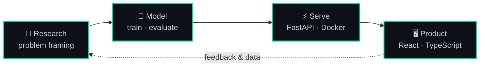

 

 

 

## 👋 About

I'm an **AI/ML Engineer and Full Stack Developer** who builds systems where research-grade models actually ship.

My work lives at the seam between two worlds: **training vision models that hold up outside a notebook**, then wrapping them in **APIs and interfaces people can use**. I care about the whole path, from the loss curve to the loading spinner.

Currently pursuing an **M.Sc. in AI & ML** at East West University while shipping AI features at **Acciptra**.

 

## 🧠 Where I Go Deep

<table>
<tr>
<td width="50%" valign="top">

### 👁️ Computer Vision
Object detection, semantic segmentation and image classification, built to survive real-world data, not just benchmarks.

</td>
<td width="50%" valign="top">

### 🧬 Self-Supervised Learning
Representation learning that gets strong results from minimal labeled data. This is also my M.Sc. research focus.

</td>
</tr>
<tr>
<td width="50%" valign="top">

### ⚙️ Model Engineering
Deep learning architectures, transfer learning and training optimization, from experiment design to reproducible runs.

</td>
<td width="50%" valign="top">

### 🚀 Full Stack Delivery
End-to-end products that serve ML in production: APIs, data layers and UIs wired to the model behind them.

</td>
</tr>
</table>

 

## 🔁 How I Work

 

## 💼 Experience & Education

<table>
<tr>
<td width="140" valign="top"><b>Feb 2026 – Present</b></td>
<td>
<b>Full-Stack Developer & AI Engineer</b> · <a href="https://acciptra.com">Acciptra</a> (Remote) 
Building full-stack AI features, from model integration to the interfaces users interact with.
</td>
</tr>
<tr>
<td valign="top"><b>May 2026 – Present</b></td>
<td>
<b>M.Sc., Artificial Intelligence & Machine Learning</b> · East West University, Dhaka 
Research focus: self-supervised representation learning.
</td>
</tr>
</table>

 

## 🛠️ Tech Stack

<table>
<tr>
<td valign="top" width="170"><strong>🤖 AI / ML</strong></td>
<td>

</td>
</tr>
<tr>
<td valign="top"><strong>📊 Data</strong></td>
<td>

</td>
</tr>
<tr>
<td valign="top"><strong>💬 Languages</strong></td>
<td>

</td>
</tr>
<tr>
<td valign="top"><strong>🔌 Backend</strong></td>
<td>

</td>
</tr>
<tr>
<td valign="top"><strong>🎨 Frontend</strong></td>
<td>

</td>
</tr>
<tr>
<td valign="top"><strong>🗄️ Data Stores</strong></td>
<td>

</td>
</tr>
<tr>
<td valign="top"><strong>☁️ Infra & Tooling</strong></td>
<td>

</td>
</tr>
</table>

 

## 📈 GitHub Activity

 

 

 

## 🎯 Currently

| | |
|:--|:--|
| 🔨 **Building** | Full-stack AI features at **Acciptra** |
| 🔬 **Researching** | Self-supervised representation learning for my M.Sc. |
| 🤝 **Open to** | Collaboration on computer vision and applied ML work |

 

### Let's build something

AI/ML projects · full-stack builds · research collaborations

<i>Building intelligent systems, one model at a time.</i>

