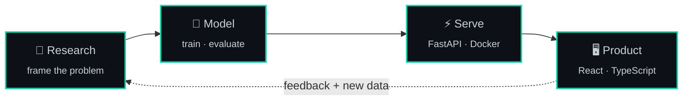

<div align="center">


<br/><br/>

<a href="https://www.linkedin.com/in/md-sakib-hasan-356304272/"></a>
<a href="mailto:sakibmunshi013@gmail.com"></a>
<a href="https://raw.githubusercontent.com/hasan-sakib/hasan-sakib/main/Md.%20Sakib%20Hasan.pdf"></a>
<a href="https://github.com/hasan-sakib"></a>

<br/>


</div>

<br/>

## `~/about.py`

```python
from dataclasses import dataclass, field


@dataclass
class SakibHasan:
    name: str = "Md. Sakib Hasan"
    roles: tuple = ("AI Engineer", "Full Stack Developer")
    location: str = "Dhaka, Bangladesh"
    education: str = "M.Sc. AI & ML @ East West University"
    working_at: str = "Acciptra (Remote)"

    focus: list = field(default_factory=lambda: [
        "Computer Vision",            # detection · segmentation · classification
        "Self-Supervised Learning",   # strong representations, minimal labels
        "Model Engineering",          # architectures · transfer learning · training
        "Full Stack Delivery",        # APIs + UIs that serve ML in production
    ])

    philosophy: str = (
        "Research-grade models only matter once they ship. "
        "I work on the seam between the two."
    )

    def ship(self, model):
        return model.train().evaluate().serve(api="FastAPI").wrap(ui="React")
```

<br/>

## `$ git log --graph --oneline`

```text
* 2026-05  (HEAD) M.Sc., Artificial Intelligence & Machine Learning
|                  East West University, Dhaka
|                  └─ research: self-supervised representation learning
|
* 2026-02  Full-Stack Developer & AI Engineer
                   Acciptra (Remote)
                   └─ building full-stack AI features, from model to interface
```

<br/>

## `$ cat pipeline.mmd`



<br/>

## `$ ls ./stack`

<table>
<tr>
<td width="150" valign="top"><b>🤖 AI / ML</b></td>
<td>
<br/>


</td>
</tr>
<tr>
<td valign="top"><b>📊 Data</b></td>
<td>
<br/>


</td>
</tr>
<tr>
<td valign="top"><b>💬 Languages</b></td>
<td></td>
</tr>
<tr>
<td valign="top"><b>🔌 Backend</b></td>
<td>


</td>
</tr>
<tr>
<td valign="top"><b>🎨 Frontend</b></td>
<td></td>
</tr>
<tr>
<td valign="top"><b>🗄️ Data Stores</b></td>
<td></td>
</tr>
<tr>
<td valign="top"><b>☁️ Infra</b></td>
<td></td>
</tr>
</table>

<br/>

## `$ gh stats --me`

<div align="center">


<br/>


</div>

<br/>

## `$ ./snake --eat contributions`

<div align="center">

<picture>
  <source media="(prefers-color-scheme: dark)" srcset="https://raw.githubusercontent.com/hasan-sakib/hasan-sakib/output/github-snake-dark.svg"/>
  <source media="(prefers-color-scheme: light)" srcset="https://raw.githubusercontent.com/hasan-sakib/hasan-sakib/output/github-snake.svg"/>
  
</picture>

</div>

<br/>

## `$ cat currently.yml`

```yaml
building:    Full-stack AI features at Acciptra
researching: Self-supervised representation learning (M.Sc.)
studying:    AI & ML at East West University
open_to:
  - Computer vision collaborations
  - Applied ML projects
  - Full-stack builds
```

<br/>

<div align="center">

## `$ ping sakib`

```text
64 bytes from sakib: AI/ML projects · full-stack builds · research collaborations
```

<a href="mailto:sakibmunshi013@gmail.com"></a>
<a href="https://www.linkedin.com/in/md-sakib-hasan-356304272/"></a>

<sub><i>Building intelligent systems, one model at a time.</i></sub>


</div>
